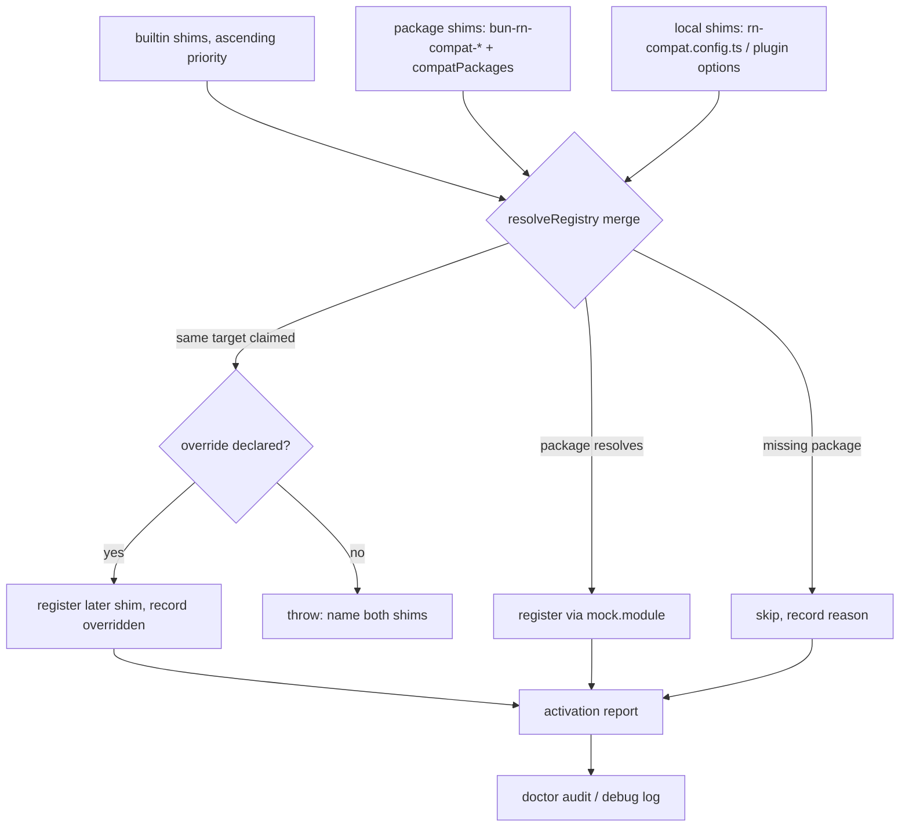

# Bun React Native/Expo Testing Compatibility Layer - Plan

## Goal Capsule

- **Objective:** A substantial Expo application can run its existing React Native test suite under `bun test` with a preload line and near-zero test edits; when a dependency is unsupported, the developer learns why in one command and closes the gap with one small file — without forking or modifying this package.
- **Means:** Evolve `bun-plugin-react-native-testing-library` (crvouga, MIT) — verified this run as the stronger foundation for its differential Jest oracle, compatibility matrix, and canary infrastructure — into a three-source shim registry with public extension APIs, a compatibility doctor, and an `jest-expo`-definitions loader (KD6). Selectively port from Censkh's `bun-test-react-native` (MIT).
- **Authority hierarchy:** Product Contract requirements (R-IDs) govern behavior; Key Decisions (KD) govern product constraints; Key Technical Decisions (KTD) govern implementation mechanism within those constraints. This handoff brief is superseded by this plan once written.
- **Stop conditions:** A discovery that `bun:test` cannot support a settled mechanism (per KD1–KD4) is reported, not worked around silently. An Expo SDK 58 blocker stops only the SDK-58 unit; the SDK-57 baseline must stay green.
- **Execution profile:** Single PR, units U1–U12 in dependency order. This run implements and ships; upstreaming back to crvouga is deferred follow-up work (KD5).
- **Who finishes:** The implementing agent (`ce-work`) executes all units; the user reviews the PR and decides on upstream contribution.

---

## Product Contract

### Summary

Turn the existing Bun plugin for React Native Testing Library into the compatibility infrastructure that makes Bun practical for testing large Expo apps: a publicly extensible shim registry (local files and npm packages), diagnostics that explain compatibility failures instead of hiding them, audit-driven coverage for high-value libraries, explicit Expo SDK 58 support, minimal-migration Jest compatibility, differential correctness validation, and a preserved performance advantage.

### Problem Frame

Teams adopt jest-expo because their suites depend on Metro resolution, Flow sources, native-module mocks, and Jest globals. Bun's runner is far faster, but gaps are hard to identify, debug, and fix — especially in large apps with many native dependencies. The bottleneck is not "library X fails" but "nothing tells me why, or what to do about it." The existing plugin solves resolution, Flow, and core RN mocks, and proves behavior against Jest with a differential oracle — but its shim registry is a hardcoded internal array: a developer facing an unsupported library must edit the package's source.

### Requirements

Adoption and extension:

- R1. An existing Expo app adopts the layer by installing the package and adding the preload line to `bunfig.toml`; the common case needs no further configuration.
- R2. A developer adds support for an unsupported native library with one small local shim file registered through the public API, without modifying this package's source.
- R3. Community shims are installable as npm packages and activate automatically when their target packages resolve from the app, with no app code changes.
- R4. Built-in shims can be disabled or overridden by project shims; registration order is deterministic; two active shims claiming the same package is an explicit error unless an override is declared.

Diagnostics:

- R5. A doctor command reports: which shims activated, which were skipped and why, which imported native modules have no shim, and a concrete next action for each gap (existing shim name, official Jest mock source, or a scaffold command).
- R6. Resolution failures for React Native ecosystem specifiers produce error messages naming the specifier, the importer, and the next action — and never substitute a silent mock for an unknown module.

Compatibility coverage:

- R7. High-value Expo/RN libraries work under the layer with faithful behavioral mocks or reused official Jest mocks, prioritized by prevalence in production Expo apps; additions are audit-driven and ship with fixtures.
- R8. When `jest-expo` is installed at the matching SDK version, its native-module definitions are the default mock source for Expo modules without hand-written shims; its absence produces a warning with the fix, never silent fallback.

Expo SDK 58:

- R9. Expo SDK 58 (React Native 0.88) is explicitly supported — CI matrix rows, an SDK-58 fixture, updated RN core mocks for removed APIs — or, where blocked, the exact blockers are documented and the SDK-57 baseline stays green.

Jest migration:

- R10. Existing Jest test files run under Bun with minimal edits: the layer fills documented `bun:test` gaps, and a migration guide documents unavoidable differences with a test reference each.

Correctness and validation:

- R11. Compatibility claims are executable: per-shim contract tests, differential Bun-vs-Jest traces for new shims, test-isolation and repeated-run checks, and regression tests for fixed gaps.
- R12. Behavioral mocks fail loudly on unimplemented behavioral paths rather than silently passing tests.

Performance:

- R13. The layer preserves a measurable cold and warm startup advantage over `jest-expo` on the same representative suite, recorded by a benchmark script; correctness outranks speed when they conflict.

### Key Decisions

- KD1. Thin compatibility layer on `bun test` — never a new framework or Jest reimplementation. (session-settled: user-directed — chosen over a new test framework or reimplementing Jest: the layer exists to run existing suites, not to invent a testing API.) Governs R1, R7, R10.
- KD2. Extensibility over built-in mock count. (session-settled: user-directed — chosen over manually supporting every library in-tree: gaps should be closable by developers themselves.) Governs R2, R3, R4.
- KD3. Faithful testing behavior over tests merely passing. (session-settled: user-directed — chosen over permissive catch-all mocks: false positives are worse than clear failures.) Governs R6, R12.
- KD4. Prefer official Jest mocks — `jest-expo` definitions and existing official mock sources — over reimplementations. (session-settled: user-directed — chosen over hand-written equivalents: official mocks track SDK changes.) Governs R7, R8.
- KD5. Upstream collaboration over a permanent fork. (session-settled: user-directed — chosen over maintaining a permanent fork: keep changes upstreamable, preserve attribution and licensing.) Governs all requirements.
- KD6. Foundation: evolve crvouga's `bun-plugin-react-native-testing-library`; port selectively from Censkh's `bun-test-react-native`. Verified this run: crvouga holds the differential oracle, compatibility matrix, canaries, and property tests; Censkh contributes the `jest-expo` definitions loader pattern, the Expo Router fixture, Expo 58 module mocks, and an SWC transform stack; both MIT. (session-settled: user-directed — chosen over building from Censkh or rewriting: the user's lean was verified against both implementations before planning.) Governs R7, R8, R9, R11.

### Scope Boundaries

In scope: registry core and public extension APIs, doctor and resolution diagnostics, audit-driven coverage additions, SDK 58, Jest-migration compat and guide, oracle/guard expansion, benchmark.

**Deferred to follow-up work:**

- Upstream pull requests to crvouga (split and sequencing decided after this run's review; KD5).
- npm publishing of the fork and of the example shim package.
- SDK versions beyond 58; additional CI OS axes.

**Outside this product's identity (non-goals):**

- A new test framework or testing API (KD1).
- Reimplementing Jest APIs that `bun:test` already provides.
- Permissive catch-all mocks for unknown modules (KD3).
- Native-device execution; Windows CI axis.

### Open Questions

- Deferred: the final U8 library-addition list is the output of the U5/U8 audit, not a planning-time deliverable (the audit is itself a unit).
- Deferred: whether upstream prefers a different extension-API shape; decided at upstream-contribution time.
- Deferred: any SDK 58 item that depends on a real `expo@^58` install (fixture bootstrap exists: `scripts/bootstrap-fixtures.ts`).

---

## Planning Contract

### Key Technical Decisions

- KTD1. Shim descriptor v2: extend `LibraryShim` (src/libraries/helpers.ts) with optional `priority`, `versionRanges`, `provenance` (`builtin` | `local` | `package`), `override`, and `surface` (`behavioral` | `presentation`) fields; existing fields unchanged so all built-in shims port with no edits. Registry consumption (src/libraries/index.ts) becomes `resolveRegistry(config)`: an ordered merge — built-ins by ascending priority, then package shims, then local shims — with conflict detection on declared mock targets: two active shims that both declare the same target are a conflict per R4 (throw naming both shims) unless the later one declares `override: true`. Cross-tier overlap is resolved by registration order (later tier wins), and the definitions loader (KTD6) declares no targets of its own — it is a gap-filler that mocks only modules no active shim claimed, so it never raises R4 conflicts and hand-written shims always win it silently. Result shape keeps `{activated, skipped}` and adds `{conflicts, overridden}`. Cites KD2.
- KTD2. Public registration API: export `defineShim()` from the package root (validates descriptor: non-empty name/packages, register function). Consumers register local shims via a convention config file `rn-compat.config.ts` at the app root, auto-loaded by the preload entry when present, exporting `{ shims?, compatPackages?, disable? }`; programmatic consumers pass the same shape to `createReactNativePlugin({ compat })`. `RN_BUN_LIBRARY_MOCKS` and `config.libraryMocks` keep working, mapped onto enable/disable lists. Chosen over a plugin-API extension mechanism (third parties shipping `BunPlugin`s into the resolution pipeline): `bun:test` `mock.module()` already overrides already-imported modules with live ESM binding updates — the thing a resolution-time plugin hook cannot do — and it is the mechanism all 40+ built-in shims use today, so one registration path serves every shim source. The plugin layer (src/index.ts) stays internal, where the oven-sh/bun#10083 strategy handling lives. Cites KD2, R2, R4.
- KTD3. npm shim discovery: preload scans the consumer `package.json` dependencies and devDependencies for names matching `bun-rn-compat-*` (documented community convention, provisional) plus explicit `compatPackages` entries; each must expose a `<pkg>/shim` export (fallback: package root) that is imported and registered like a local shim. A package that resolves but lacks the export is a doctor-reported error, not a silent skip. Cites KD2, R3.
- KTD4. Doctor CLI: new `bin` entry `bun-rn-doctor` with subcommands `audit` (default) and `scaffold <package>`. Audit reuses `resolveRegistry` plus a dependency scan to produce the R5 report; scaffold writes `rn-compat.shims/<package>.ts` (starter shim + registration snippet) using the U3 API. Exit code 1 when unmocked native modules are detected. Cites R5.
- KTD5. Resolution-failure diagnostics: in the plugin's `onResolve` fallback (src/index.ts), a failed resolution of an ecosystem-shaped specifier (heuristics: `react-native-*`, `expo-*`, `@react-native-*`, `@expo-*`, packages shipping `android`/`ios` native dirs) produces a structured error naming specifier, importer, whether any registry source has a matching shim (including a disabled one — the error says so), and the fix command. Non-ecosystem failures pass through untouched. Never returns a mock module. Cites KD3, R6.
- KTD6. `jest-expo` definitions loader: attributed port of Censkh's `src/mock/ExpoPresetModuleMocks.ts` approach (MIT; NOTICE entry + header comment). `jest-expo` stays peer-optional; the loader reads `jest-expo/src/preset/moduleMocks/{expoModules,thirdPartyModules,internalExpoModules}`, deep-merges them, and materializes descriptor objects (function/number/string/array/mock) into mock values. Exposed as a lowest-priority fallback shim (KTD1 ordering) so hand-written built-ins always win. Version mismatch between `expo` and `jest-expo` warns once with the fix. Cites KD4, R8.
- KTD7. SDK 58 support: add an `expo@^58` real-world fixture (bootstrap pattern of `scripts/bootstrap-fixtures.ts`), matrix rows for RN 0.88 + React 19.3 in `scripts/compat/run-matrix.ts`, RN core mock updates for 0.87/0.88 removals (`InteractionManager` → `requestIdleCallback`-backed model, `Touchable` export removal, `Modal` `animated` prop, `StatusBar` props), and `jest-expo@~58` in the loader's test matrix. Blockers, if any, documented in docs/compatibility.md with exact errors; SDK-57 baseline untouched. Cites R9.
- KTD8. Oracle and guard expansion: extend the oracle corpus (test/oracle) to cover the definitions loader and each new U8 shim; add false-positive guards — every behavioral shim ships a contract test asserting observable behavior, and a loudness test asserting that unimplemented behavioral paths throw where the official Jest mock throws. Isolation checks reuse the existing walk/soak infrastructure (`test:walk`, `test:soak` — `RN_BUN_FC_RUNS`) for repeated and parallel runs of the Expo fixture. Cites R11, R12.
- KTD9. Performance benchmark: `scripts/bench/run-bench.ts` measuring cold (fresh process, cold transform cache) and warm wall-clock for the Expo fixture under the plugin vs `jest-expo` (Jest stays fixture-only, mirroring the oracle's pattern). Results to `.compat-out` and docs/compatibility.md; record-only, not a CI gate initially. Cites R13.

### High-Level Technical Design

Registry resolution — three sources, ordered, conflict-gated:



Component relationships — the layer stays thin over `bun test`:

```mermaid
flowchart LR
  BF[bunfig preload] --> PRE[preload.ts: globals, jest shims, plugin()]
  PRE --> REG[resolveRegistry]
  REG --> MM[bun:test mock.module]
  PRE --> PLG[BunPlugin: platform resolve, Flow transform, assets, failure diagnostics]
  CFG[rn-compat.config.ts + compatPackages] --> REG
  JE[jest-expo moduleMocks definitions] --> DEF[definitions loader: lowest-priority shim] --> REG
  DOC[bun-rn-doctor] --> REG
  ORC[oracle / matrix / bench scripts] --> FIX[fixtures: real-world, real-world-expo, oracle jest-fixture]
```

### Assumptions

- Package and repo identity stay unchanged this run (rename/scope decisions belong to upstream contribution; KD5).
- This run ships one PR; the upstream PR split is follow-up work.
- Community shim naming convention `bun-rn-compat-*` is provisional and documented as such.
- Bun `>=1.4.0` remains the minimum (CI pins 1.4.0 + latest; local dev verified on 1.4.4 this run).
- GitHub fork creation is executable: `gh` authenticated as `andrew-bierman` with `repo` scope (verified this run).
- `jest-expo` remains peer-optional and fixture-only, never a root dependency (upstream's own oracle pattern, preserved).

### System-Wide Impact

Public compatibility surfaces this work touches — all changes additive or opt-in; existing consumers keep current behavior:

- Package exports (`.` factory, `./preload`, `./screen`) keep their signatures; new exports (`defineShim`, compat config types) are additive.
- The preload entry keeps loading with zero config and identical behavior when no `rn-compat.config.ts` exists (U3 scenario pins this).
- Environment variables (`RN_BUN_LIBRARY_MOCKS`, `RN_BUN_PLATFORM`) keep working, remapped onto the new enable/disable lists.
- The exported `libraryRegistry` and `registerLibraryMocks` result shape stay compatible; new fields (`conflicts`, `overridden`) are additions.
- The `bunfig.toml` quick-start in the README remains the documented adoption path (R1).
- New surface: `bun-rn-doctor` bin and the `rn-compat.config.ts` convention — introduced by U3/U5, documented in README and docs/compatibility.md.

### Risks & Dependencies

- **`jest-expo` internal module paths (KTD6).** The definitions loader reads `jest-expo/src/preset/moduleMocks/*`, which is not a public API and can move between SDK majors. Mitigation: the loader is isolated in one attributed module, per-SDK contract tests run in the matrix (U7/U9), absence or moved paths degrade to the documented hand-written mocks with a doctor-visible warning — never a hard failure. Accepted residual: a mid-cycle jest-expo restructure could drop definition coverage for new modules until the loader is updated.
- **Bun version churn.** The plugin already works around oven-sh/bun#10083 with probe-based strategy selection; CI pins Bun 1.4.0 and latest. New Bun releases may change `mock.module` or plugin semantics; the differential oracle is the tripwire (U11).
- **CI time growth.** The SDK-58 fixture adds install weight. Mitigation: fixture bootstrap caching (`scripts/bootstrap-fixtures.ts` pattern) and matrix rows run in the full check, not every job.
- **Upstream divergence (KD5).** This fork may drift from crvouga. Mitigation: changes stay upstreamable (no rewrites, attribution preserved), and the deferred upstream-PR split is recorded in the PR body.

---

## Implementation Units

### U1. Fork, baseline, and working environment

- **Goal:** Establish the fork as the working repo with a green, recorded baseline before any code change.
- **Requirements:** Supports all (KD5, KD6).
- **Dependencies:** None.
- **Files:** GitHub fork under `andrew-bierman` + remotes (fork `origin`, upstream kept); `.compat-out/baseline.json` (gitignored output, not committed); README attribution section noting upstream and Censkh ports.
- **Approach:** Create the GitHub fork (`gh repo fork`), wire remotes on the existing local clone, `bun install`, run `bun run check:quick` and `bun run compat:matrix`/`compat:oracle`; record test counts and cold wall time to `.compat-out/baseline.json` for U12 comparison.
- **Execution note:** Run the existing suite before any change; pre-existing failures are recorded as baseline and reported, not fixed silently.
- **Test scenarios:** Test expectation: none — environment setup; proven by the Verification commands.
- **Verification:** `bun run check:quick` green on the unmodified baseline; fork remote pushable; baseline file written.

### U2. Registry core: ordered resolution with conflicts and overrides

- **Goal:** Replace fixed `LIBRARY_REGISTRY` consumption with the ordered, conflict-checked three-source registry (KTD1).
- **Requirements:** R4 (KD2).
- **Dependencies:** U1.
- **Files:** src/libraries/helpers.ts, src/libraries/index.ts, src/config.ts, test/unit/libraries.test.ts, test/contract/library-registry.test.ts.
- **Approach:** Extend `LibraryShim` per KTD1; add `resolveRegistry(config)`; keep `registerLibraryMocks` result shape plus `{conflicts, overridden}`; `disable` list semantics; deterministic order built-ins → packages → locals.
- **Patterns to follow:** Existing `shouldRegister`/`registerLibraryMocks` flow and its error style (`[rn-bun]` prefix, named lists).
- **Test scenarios:**
  - Local shim claiming a built-in's package overrides it only with `override: true`; otherwise throws naming both shims.
  - `disable: ["reanimated"]` skips that built-in; others still activate.
  - Activation sequence proves package shims run between built-ins and local shims.
  - Shim with partially-resolving `packages` stays skipped, no error.
  - Result reports `conflicts`/`overridden` arrays accurately.
  - All existing built-ins activate exactly as before (regression via real-world suites).
- **Verification:** `bun test test/unit/libraries.test.ts test/contract/library-registry.test.ts`; `test:real-world` unchanged-green.

### U3. Public local-shim registration API

- **Goal:** One-file local shims through a public API (R2).
- **Requirements:** R2, R1 (KD2).
- **Dependencies:** U2.
- **Files:** src/compat-config.ts (new), src/index.ts, src/preload.ts, examples/local-shim/ (new), test/contract/local-shims.test.ts, README section.
- **Approach:** `defineShim()` validation; `rn-compat.config.ts` auto-load in preload; `createReactNativePlugin({ compat })` programmatic path; invalid descriptors error with the file path and reason.
- **Test scenarios:**
  - Config file with one shim activates when its package resolves; skipped with reason when not.
  - Invalid descriptor (empty packages, missing register) produces a named error including the config file path.
  - No config file → zero-config path identical to today.
  - Plugin-options route registers equivalently to the config-file route.
- **Verification:** Contract tests green; `examples/local-shim` suite green.

### U4. npm-distributed shim packages

- **Goal:** Community shims as installable, auto-activating packages (R3).
- **Requirements:** R3 (KD2).
- **Dependencies:** U2, U3.
- **Files:** src/compat-config.ts (discovery), examples/shim-package/ (publishable example, wired via `file:` in a fixture), test/contract/shim-packages.test.ts, README.
- **Approach:** KTD3 discovery; missing-export case surfaces in the activation report for U5; explicit `compatPackages` beats discovery order.
- **Test scenarios:**
  - Fixture app with a `bun-rn-compat-*` dependency activates it with no app code.
  - Package present but missing `/shim` export → reported error entry, not silent skip.
  - Explicit `compatPackages` entry wins over discovery-sourced duplicate.
- **Verification:** Contract tests green; example documented.

### U5. Compatibility doctor

- **Goal:** The R5 diagnostics command.
- **Requirements:** R5 (KD3).
- **Dependencies:** U2, U4.
- **Files:** scripts/doctor.ts (new), package.json `bin`, test/unit/doctor.test.ts, test/contract/doctor.test.ts, docs/compatibility.md (new).
- **Approach:** KTD4; audit table (shim, state, reason, action); scaffold via U3 API; exit code 1 on unmocked native modules; runs the same resolution path as preload so its report cannot drift from reality.
- **Test scenarios:**
  - Audit on the Expo fixture lists activated/skipped shims with reasons.
  - `scaffold expo-widget` writes a valid shim file that registers through U3 and activates.
  - Fixture importing a native module with no shim → exit 1 with suggestion.
  - RN-only app without `expo` does not require `jest-expo` and reports cleanly.
- **Verification:** Unit + contract tests; run `bun-rn-doctor audit` on `test/real-world-expo` and include the report in the PR body.

### U6. Actionable resolution failures

- **Goal:** Loud, guided errors for unresolvable ecosystem modules (R6).
- **Requirements:** R6 (KD3).
- **Dependencies:** U2, U5 (report shape exists).
- **Files:** src/diagnostics.ts (new), src/index.ts (onResolve fallback), test/contract/resolution-failures.test.ts.
- **Approach:** KTD5 heuristics; message names specifier, importer, matching shim (including disabled ones), and the doctor command.
- **Test scenarios:**
  - Unresolvable `react-native-xyz` import errors with specifier, importer, and doctor hint.
  - Same for `expo-*` and `@react-native-community/*` shapes.
  - Disabled-but-existing shim is named in the error.
  - Non-ecosystem unresolvable import is unaffected.
  - No code path substitutes a mock module for the failure.
- **Verification:** Contract tests green; manual failure run shows the message.

### U7. jest-expo definitions loader

- **Goal:** Official native-module definitions as the default fallback mock source (R8).
- **Requirements:** R8 (KD4).
- **Dependencies:** U2 (priority ordering).
- **Files:** src/libraries/expo/definitions.ts (new, attributed port), src/libraries/expo/index.ts, NOTICE (new), test/contract/definitions-loader.test.ts.
- **Approach:** KTD6; lowest-priority built-in; warn-once on SDK mismatch; hand-written shims always win.
- **Test scenarios:**
  - With `jest-expo@~57` installed, an unmocked Expo module resolves with a working mock surface derived from definitions.
  - A hand-written shim (e.g. expo-camera) still takes precedence over the definitions fallback.
  - `jest-expo` absent → shim skipped silently-compatible (no error), R8 warning surfaces in doctor.
  - expo/jest-expo version mismatch warns once.
- **Verification:** Contract tests green; `test:real-world-expo` stays green with the loader enabled.

### U8. Coverage expansion (audit-driven)

- **Goal:** Close audited gaps for high-value libraries with faithful mocks and fixtures (R7).
- **Requirements:** R7 (KD3, KD4).
- **Dependencies:** U5 (audit report), U7 (definitions loader reduces hand-written need).
- **Files:** src/libraries/ additions per audit, test/contract/<new>.test.ts per addition, test/real-world/ fixture entries, docs/compatibility.md matrix updates.
- **Approach:** Audit from U5's report plus the registry's coverage table; the audit's concrete deliverable is a per-library verdict table in docs/compatibility.md (library, state: covered-behavioral / covered-presentation / broken / uncovered, evidence), produced during U5 and finalized here — U8 adds shims only for rows marked broken or uncovered. Each addition = shim + observable-behavior contract test + fixture entry; port superior Censkh behavioral mocks with attribution. Presentation-only no-op shims are labeled `surface: "presentation"` (KTD1) so they cannot masquerade as behavioral.
- **Execution note:** Audit first; add only uncovered or demonstrably broken integrations.
- **Test scenarios (per addition; representative set):**
  - expo-router: render + navigation smoke test (Censkh fixture pattern), async settle behavior.
  - SQLite (expo-sqlite / op-sqlite): executes statements against an in-memory model and persists across handle reuse within a test.
  - MMKV: set/get/delete across instances in one process.
  - TanStack Query: hook test passes with real (non-faked) timings.
  - Each presentation-only shim renders children and forwards `testID` props.
- **Verification:** New contract tests green; `test:real-world` green; coverage matrix in docs/compatibility.md updated.

### U9. Expo SDK 58 support

- **Goal:** Explicit, tested SDK 58 support or documented blockers (R9).
- **Requirements:** R9 (KD6).
- **Dependencies:** U7 (definitions loader consumes `jest-expo@~58`), U2.
- **Files:** test/real-world-expo/ (SDK-58 fixture), src/mocks/ (RN 0.88 removal updates), scripts/compat/run-matrix.ts, docs/compatibility.md.
- **Approach:** KTD7. Add fixture + matrix rows first, then fix what breaks in RN core mocks; verify oracle identity on the upgraded oracle fixture; keep the SDK-57 baseline green throughout.
- **Test scenarios:**
  - `expo@^58` fixture installs and its suite passes under the plugin.
  - `InteractionManager` import behaves as the requestIdleCallback-backed shim defines.
  - `Touchable` import fails with a migration-pointing error consistent with RN 0.88.
  - Oracle traces on the upgraded fixture are identical under Bun plugin and Jest.
  - SDK-57 real-world-expo suite remains green.
- **Verification:** Matrix 0.88 row green; fixture green; any blocker documented with exact errors.

### U10. Jest compatibility audit + migration guide

- **Goal:** Minimal-migration Jest compat with documented deltas (R10).
- **Requirements:** R10 (KD1).
- **Dependencies:** U1 (baseline).
- **Files:** src/jest-shims.ts, test/contract/jest-compat.test.ts (new), docs/migration-jest.md (new).
- **Approach:** Verify the actual `bun:test` `jest` surface first (docs list `mock`, `doMock`, `requireActual`, `resetModules` as present); shim only verified gaps (candidates: `resetAllMocks`, setImmediate default-faking difference, `doMock` hoisting semantics); every documented difference gets a test that fails without the shim and passes with it.
- **Test scenarios:**
  - `jest.mock`/`jest.requireActual` round-trip works through the `bun:test` jest global.
  - `resetModules` isolates module state across tests.
  - Fake timers + `advanceTimersByTimeAsync` drive an RNTL `waitFor`.
  - Snapshot write/update works in an RN render test.
  - Each guide-listed delta references its test.
- **Verification:** jest-compat suite green; docs/migration-jest.md complete with test references.

### U11. Differential validation, false-positive guards, isolation

- **Goal:** Executable correctness claims (R11, R12).
- **Requirements:** R11, R12 (KD3).
- **Dependencies:** U7, U8, U9 (their surfaces get validated).
- **Files:** test/oracle/ (corpus expansion), test/contract/guards.test.ts (new), test/integration/ (isolation checks), scripts/compat/run-oracle.ts (wiring if needed).
- **Approach:** KTD8. Oracle corpus gains traces for the definitions loader and each U8 addition; guards assert observable mock behavior and loud failure on unimplemented behavioral paths; isolation reuses walk/soak patterns for repeated and parallel Expo-fixture runs.
- **Test scenarios:**
  - New-shim oracle traces identical under Bun plugin and Jest.
  - Guard tests fail when a shim's mock behavior is removed (the tests test the shims).
  - Loudness: unimplemented behavioral path throws where the official Jest mock throws.
  - Repeated-run and parallel-run isolation checks stay green.
- **Verification:** `bun run compat:oracle` green with expanded corpus; `test:walk`/`test:soak` green.

### U12. Performance benchmark vs Jest

- **Goal:** Record the preserved speed advantage (R13).
- **Requirements:** R13 (KD3-correctness-first, KD1).
- **Dependencies:** U1 (baseline), U9 (SDK fixture is the representative suite).
- **Files:** scripts/bench/run-bench.ts (new), docs/compatibility.md (numbers section).
- **Approach:** KTD9. Cold and warm wall-clock of the Expo fixture under the plugin vs `jest-expo`; environment metadata in the report; record-only.
- **Test scenarios:** Test expectation: none — measurement harness; correctness is U11's contract; the bench reports both numbers with environment metadata.
- **Verification:** Bench runs green producing `.compat-out` report; docs table populated against U1's baseline.

---

## Verification Contract

| Gate | Command | Proves |
| --- | --- | --- |
| Format, lint, types, unit suite | `bun run check:quick` | Standard pre-push quality bar |
| Canonical release gate | `bun run check` | Upstream's release law (writes `.compat-out/release-report.json`) |
| Version matrix | `bun run compat:matrix` | RN/React/RNTL envelope incl. new 0.88 rows |
| Differential correctness | `bun run compat:oracle` | Bun plugin traces ≡ Jest preset traces |
| Interaction walks | `bun run compat:walks` | Stateful RNTL interaction sequences |
| Coverage accounting | `bun run compat:coverage` | Registry/fixture coverage claims |
| Real-world suites | `bun run test:real-world`, `bun run test:real-world-expo` | Production-library compatibility incl. SDK 58 |
| Canaries | `bun run test:canaries` | Regression canaries |
| Doctor smoke | `bun-rn-doctor audit` on `test/real-world-expo` | R5 report quality (report included in PR) |
| Benchmark | `bun run scripts/bench/run-bench.ts` | R13 numbers recorded |

---

## Definition of Done

- Every unit's Verification entry is green; `bun run check` passes end to end.
- Docs updated: README extension quick-start, docs/compatibility.md (matrix, doctor, bench numbers), docs/migration-jest.md.
- NOTICE and code-header attributions present for all ported Censkh code; upstream attribution preserved in README.
- No abandoned-attempt code, debug scripts, or scratch fixtures left in the diff.
- PR body includes: baseline vs final test counts and bench numbers, the doctor audit report, and any residual findings or deferred items.

---

## Appendix

### Sources and Research

- Local (working clone): src/libraries/helpers.ts (LibraryShim, `mockBoth` via `bun:test` `mock.module`), src/libraries/index.ts (LIBRARY_REGISTRY, `registerLibraryMocks`), src/index.ts (platform resolution, Flow-transform strategies around oven-sh/bun#10083, asset stubs), src/config.ts (`libraryMocks` filter surface), src/preload.ts (globals: `__DEV__`, `IS_REACT_ACT_ENVIRONMENT`, ErrorUtils, `EXPO_OS`), src/jest-shims.ts (patches global jest/bun:test jest), scripts/compat/run-oracle.ts (nested jest-fixture, trace comparison), test/real-world-expo/package.json (expo 57.0.20 pin), .github/workflows/ci.yml (commitlint + bun check on Linux/Bun 1.4.0 and macOS/latest).
- Censkh audit clone (/tmp/opencode/research/bun-test-react-native): src/mock/ExpoPresetModuleMocks.ts (loads jest-expo moduleMocks definitions, descriptor materialization), src/setup.ts (expo global stub, `nativeModuleProxy`/`__turboModuleProxy`, missing-jest-expo warning), MIT license (James Waterhouse).
- External: Expo SDK 58 stable released Oct 15 2026 with React Native 0.88 + React 19.3; removals: `InteractionManager` (→ `requestIdleCallback`), `Touchable` root export, `NativeMethods` types, `Modal` `animated`, several `StatusBar` props; RN 0.87 defaults Strict TypeScript API (deep `react-native/Libraries/` imports become type errors; opt-out until 0.89) — expo.dev/changelog/sdk-58-beta and release coverage.
- External: Bun docs — bun.com/docs/test/mocks (`mock.module` overrides already-imported modules, CJS+ESM, pending-promise factories; `jest` exposes `mock`, `doMock`, `unmock`, `dontMock`, `requireActual`, `requireMock`, `createMockFromModule`, `resetModules`), bun.com/docs/test/dates-times (fake timers: `setImmediate` stays real under `bun:test`, `nextTick`/`queueMicrotask` not faked by default), bun.com/docs/test/snapshots (Jest-style snapshots, `--update-snapshots`).
